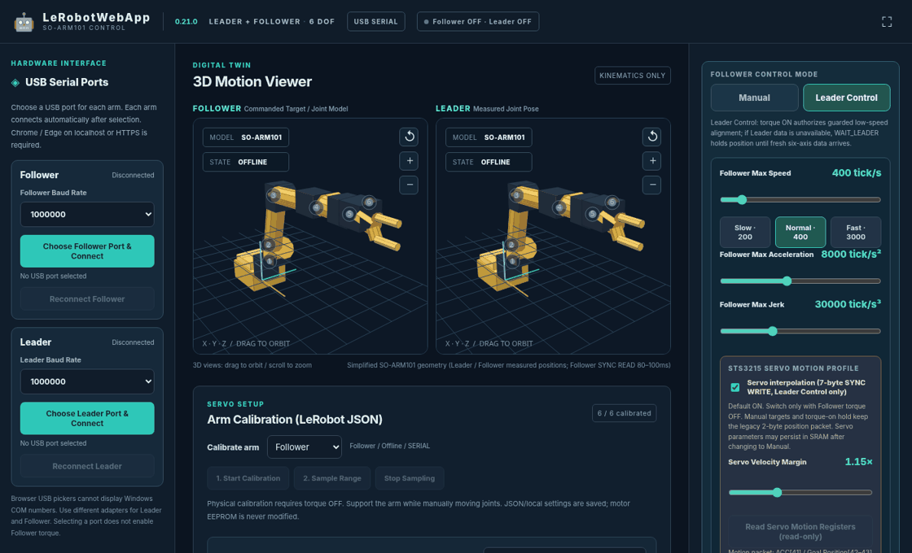

# LeRobotWebApp



## Overview

LeRobotWebApp is a browser-based USB controller and 3D viewer for SO-ARM101 Leader and Follower robots using Feetech serial servos.

## Quick Start

Demo page (available after the project is published to GitHub Pages):

https://covao.github.io/LeRobotWebApp/LeRobotWebApp.html

To run the included application locally, open a terminal in the `LeRobotWebApp` folder:

```bash
python -m http.server 8000
```

Open `http://localhost:8000/LeRobotWebApp.html` in Chrome or Edge.

## Features

- Connect Leader and Follower arms through separate USB serial ports.
- View both arms with interactive 3D joint visualization.
- Follow Leader joint positions or control the Follower manually.
- Import, export, and edit LeRobot-compatible calibration data.
- Use jerk-limited S-curve trajectories and optional servo-side interpolation.
- Send six-axis SYNC WRITE commands with position, acceleration, and speed.
- Read servo states, monitor communication, and export diagnostics.
- Protect Follower motion with torque controls, alignment checks, and verified servo limits.

## Requirements

- Chrome or Edge with Web Serial support (desktop recommended).
- Localhost or HTTPS for serial port access.
- SO-ARM101 Leader and/or Follower hardware with supported Feetech serial servos.
- USB serial interfaces and the appropriate drivers.
- A physical emergency stop or accessible power cutoff for bench testing.
- Python 3 for the optional local HTTP server.

## Usage

1. Power the supported arms and keep the Follower torque OFF during setup.
2. Open the application and select the Follower and Leader USB ports. The default baud rate is 1,000,000.
3. Verify the loaded calibration ranges for both arms. The provided JSON files are loaded from the application folder. The same values are embedded for standalone use.
4. Select **Leader Control** to follow the Leader or **Manual** for individual Follower joint commands.
5. Enable Follower torque only when the workspace is clear and the arm is supported. Begin with low motion limits.
6. Use the diagnostic panel to inspect servo feedback, export logs, or read back servo motion registers.

The bundled `my_awesome_leader_arm.json` and `my_awesome_follower_arm.json` files come from the supplied calibration data. They define six joints, homing offsets, drive modes, and range limits. Local browser settings may override these defaults after you import or save another calibration. To use the bundled defaults again, clear this application's site data or reimport the JSON files.

**Safety:** The project has been tested with a simulated serial bus; physical-hardware validation of version 0.21.0 has not been completed. The Web Serial polling loop is best-effort, not real-time. Follower torque is OFF by default. The application does not rewrite servo EEPROM values. Use a physical emergency stop and confirm servo limits before operation.

## Reference

- [LeRobot](https://github.com/huggingface/lerobot): Robot learning tools and calibration format.
- [SO-ARM100 / SO-ARM101](https://github.com/TheRobotStudio/SO-ARM100): Arm geometry and robot documentation.
- [Feetech motor SDK](https://github.com/ftabcc/feetech_motor): SMS/STS serial servo control protocol and register usage.
- [Web Serial API](https://developer.mozilla.org/en-US/docs/Web/API/Web_Serial_API): Browser access to serial hardware.

---

**Version:** 0.21.0  
**Base release:** 0.20.0  
**Changes:** Project renamed to LeRobotWebApp; supplied Leader/Follower calibration embedded and bundled; documentation and tests updated. Motion-control behavior from version 0.20.0 is retained.
